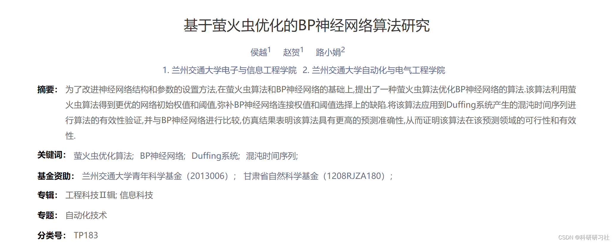
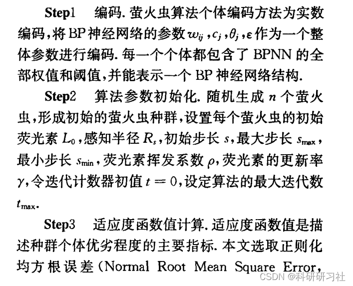
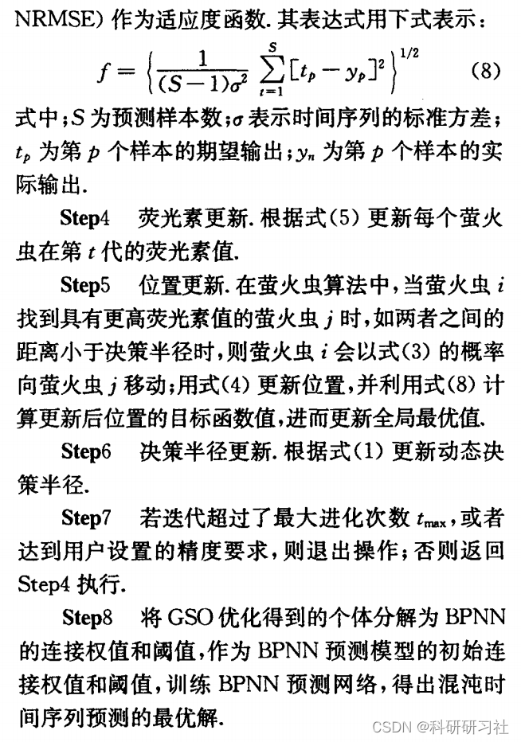
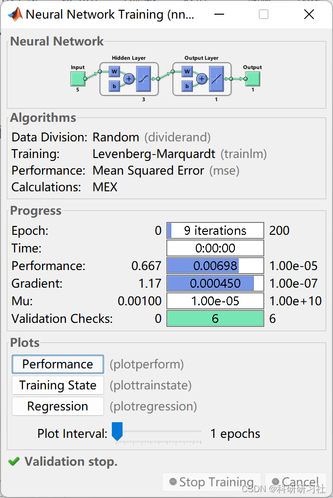
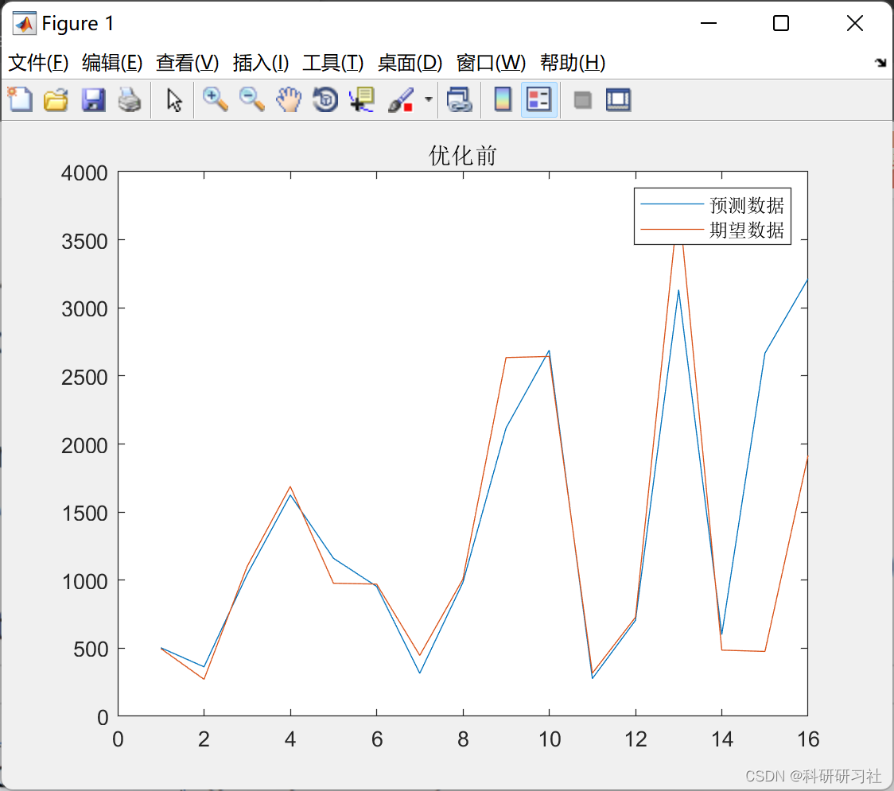
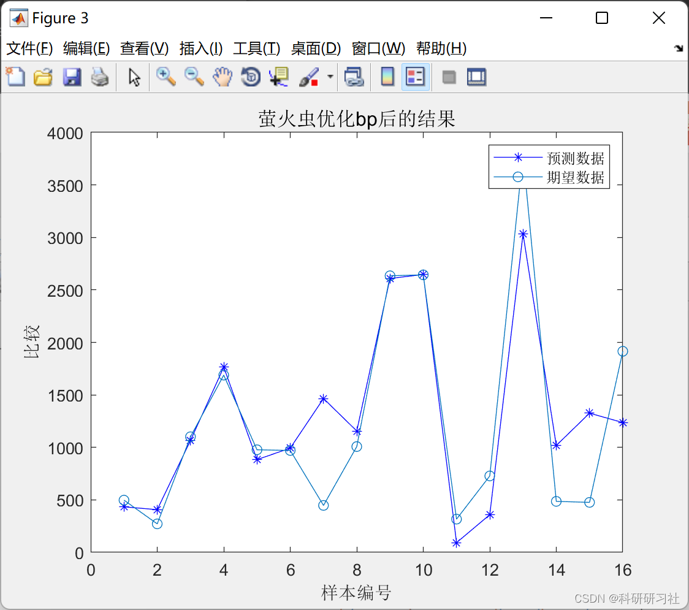

# [FA-BP] Optimized BP Neural Network Prediction Model Based on Firefly Algorithm (Matlab Code Implementation)

​  
Editor
1. Overview: Chaos phenomena are ubiquitous in the real world, governing everything from the cosmos to elementary particles. For example, climate change is a result of chaos theory.
The phenomenon of chaos exists in mathematics, physics, chemistry, and biology. The emergence of chaos has broken down the boundaries between disciplines, making it a field of interdisciplinary research.
Emerging interdisciplinary fields. With the development of nonlinear dynamics, chaos time series prediction has become a hot topic in the field of chaos research. Many...
Experts and scholars have conducted numerous research works in this field, such as the EMD algorithm [1], the joint entropy expansion method [2], Support Vector Machine 3L, Volterra filters [4], BP neural network models [5], RBF neural network models [6], and some hybrid models [783]. Among these predictive algorithms, neural networks have become a hot topic of research for many experts and scholars due to their excellent generalization ability and strong learning capabilities. However, in practical applications, the initial weights and thresholds in neural networks significantly affect their optimization performance. The Glowworm Swarm Optimization (GSO) is a new population intelligence algorithm that simulates the courtship or foraging behavior of fireflies [10]. It not only possesses strong global optimization capabilities but also does not require gradient information of the objective function, features such as ease of use, robustness, and easy implementation, making it very suitable for parameter optimization in neural networks.
This paper starts from nonlinear time series and proposes a method (GSOBPNN) that uses the Firefly Algorithm to optimize the BP neural network. This algorithm utilizes the Firefly Algorithm to obtain better initial weights and thresholds for the network, utilizing this method to compensate for the randomness in the selection of connection weights and thresholds in the BP neural network. The method is applied to predicting and analyzing chaotic time series generated by the Duffing system, with simulation results indicating that the algorithm has higher predictive accuracy.
2. Firefly Algorithm
The basic Firefly Algorithm is a new type of population intelligence optimization algorithm proposed by Krishnanad et al. in 2005 [8]. It simulates the search and optimization process as the attraction and movement of fireflies, and solves the problem's objective function to quantify the quality of the firefly's position. In the Firefly Algorithm, each firefly is distributed within the definition space of the objective function, and these fireflies have their own decision radius and carry fluorescent powder. The brightness of a firefly is determined by its position in the objective function value, and the brighter the position, the better the objective function value, which can attract more fireflies towards that direction. Since each firefly has its own decision radius, the decision radius is also affected by the neighboring fireflies. When the number of surrounding fireflies is small, the decision radius of the firefly will increase, thereby attracting more surrounding fireflies. When the number of surrounding fireflies is large, the decision radius will decrease. Ultimately, the vast majority of fireflies will gather at several positions with better objective function values.
3. Firefly Algorithm Optimization of BP Neural Network Algorithm Design
3.1 Basic Thought
The basic thought of GSO-BPNN is: according to the input and output parameters to determine the network structure of BPNN, thereby determining the encoding length of each individual in the Firefly Algorithm. Each individual in the population contains all the weights and thresholds of BPNN, and through the fitness function calculates the fitness function value of an individual. Through position update, decision radius update and fluorescent substance update, find the best function value corresponding to an individual. The GSO optimized individuals are assigned to the initial weights and thresholds of BPNN, then use the BPNN network model for optimization, thus obtaining the BPNN prediction value with global optimal solution.
3.2 Firefly Algorithm Optimization of BP Neural Network Algorithm
4 Matlab Code and Article
This article only displays part of the code, all codes and articles can be found in:
Based on Firefly Algorithm Optimization of BP Neural Network Prediction Model (Matlab Code Realization)
5 Run Results
Editors
Editors
Editors
6 References [1] Hou Yue, Zhao He, Lu Xiaojuan. Research on the BP Neural Network Algorithm Based on Firefly Optimization [J]. Journal of Lanzhou Jiaotong University, 2013, 32(06): 24-27.

## Images

<!-- PAYMENT_BLOCK -->

## Get this dataset

- Payment link (Stripe): [Buy now](https://buy.stripe.com/3cs8yP7sY87d0vu9AB)
- Payment QR code: 

<!-- /PAYMENT_BLOCK -->
